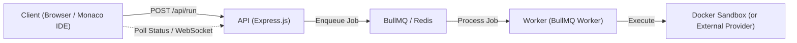

<div align="center">

<!-- CAPSULE RENDER HEADER -->


<!-- ANIMATED TYPING SVG -->
<a href="https://git.io/typing-svg">
  
</a>

<br/>

<!-- BADGES -->
<a href="https://codeflow-sand.vercel.app/"></a>
<a href="https://react.dev/"></a>
<a href="https://nodejs.org/"></a>
<a href="https://www.docker.com/"></a>
<a href="https://redis.io/"></a>
<a href="https://socket.io/"></a>
<a href="https://deepmind.google/technologies/gemini/"></a>

</div>

---

##  About CodeFlow



```yaml
Project Name   : CodeFlow 🛠️⚡
Type           : Enterprise Cloud-Native Collaborative IDE
Frontend       : React 19, Monaco Editor, Tailwind CSS v4
Backend        : Node.js 20, Express, Socket.io, Mongoose
Sandboxing     : Ephemeral Isolated Docker Containers
Queue System   : Redis + BullMQ Asynchronous Task Queue
AI Engine      : Google Gemini 2.5 Flash API
Load Balancer  : NGINX Reverse Proxy (Sticky Sessions) + PM2 Cluster
Deployment     : Vercel (Frontend) + Render / Ubuntu VPS (Backend)
```

**CodeFlow** is a production-grade, cloud-native collaborative development workspace and online IDE engineered for high availability and low-latency interaction. 

It combines a **VS Code-grade in-browser editor** with isolated multi-language execution sandboxes, real-time multiplayer pair programming, an asynchronous distributed job queue, and automated AI-driven code reviews.

---

## 🏛️ System Architecture



---

## 📊 Benchmarks & Performance

### Execution Pipeline Benchmark

| Architecture / Path | Language | Workload & Concurrency | Test Runs | Throughput | Enqueue Latency | End-to-End Latency | Reliability & Errors |
| :--- | :--- | :--- | :---: | :--- | :--- | :--- | :--- |
| **Direct (synchronous) path** | Python | 50 users, 60s | 1 run | 4.85 jobs/s | N/A (blocking) | p95 9.75s | 39 execution timeouts |
| **Queued path** | Python | 50 users, 60s, worker concurrency 8 | 2 runs | 4.95 jobs/s avg | p95 ~132ms | e2e p95 ~14.9s | 0 timeouts, 0 errors |
| **Queued path** | JavaScript | 25 users, 60s, concurrency 8 and 12 | 4 runs total | 6.1-7.0 jobs/s | p50 ~25-35ms | e2e p95 4.3-7.3s | 0 errors across 1,537 jobs |

**Methodology:** single laptop (12-core i5-12500H, 16GB, Windows 11 + Docker Desktop/WSL2), k6 running on the same machine, 2 runs per config.

---

## ⚠️ Limitations

* DSA submit endpoint still runs test cases synchronously outside the queue;
* Under heavy load latency grows instead of requests failing;
* Live demo uses an external execution API because Render has no Docker daemon, while benchmarks ran on local Docker.

---

## 🚀 Powerful & Scalable Features

### 🔒 1. Secure Containerized Execution Sandbox
* **Multi-Language Runtimes:** Instant code execution for **Python 3**, **JavaScript (Node.js)**, **C++ (GCC)**, and **Java**.
* **Strict Docker Security Constraints:**
  * Network isolation (`--network none`)
  * Hard RAM caps (`-m 256m`) and CPU quota limits
  * Execution timeout enforcement to prevent infinite loops and resource exhaustion attacks.

### 👥 2. Real-Time Multiplayer Collaboration
* **Synchronized Editor Buffers:** Sub-10ms WebSocket room synchronization powered by **Socket.io**.
* **Workspace Forking & Sharing:** Instantly fork any public or team workspace into an independent workspace with 1 click.
* **Sticky Session Load Balancing:** Configured with NGINX `ip_hash` so WebSocket connections maintain sticky sessions across worker processes.

### ⚡ 3. Asynchronous Queue Architecture
* **Non-Blocking Infrastructure:** Heavy code execution workloads are dispatched to a **BullMQ** queue backed by **Redis**, ensuring API worker threads stay fast and responsive.
* **PM2 Cluster Scaling:** Automatically scales Node.js Express across all available CPU cores using PM2 (`instances: "max"`).

### 🤖 4. AI-Powered Code Intelligence
* **Google Gemini 2.5 Flash Engine:** Integrated AI code companion providing:
  * **Automated Code Reviews:** Instant feedback on logic bugs, syntax errors, and edge cases.
  * **Big-O Complexity Analysis:** Real-time Time & Space complexity calculation.
  * **Refactoring Suggestions:** Production-ready code improvements with detailed explanations.

### 📚 5. DSA & Competitive Programming Engine
* **Love Babbar 450 Integration:** Pre-loaded with curated Data Structures & Algorithms sheets categorized by topic and difficulty.
* **LeetCode-Style Submissions:** Automated test case validation with custom input support.
* **Telemetry & Analytics:** Tracks submission history, streak statistics, and completion metrics.

---

## 🛠️ Complete Tech Stack Grid

| Layer | Technologies & Badges |
| :--- | :--- |
| **Frontend UI** |     |
| **Editor Core** |  *(VS Code Core Engine)* |
| **Backend API** |   |
| **WebSockets** |  *(Live Editor Room Sync)* |
| **Database & Storage** |   |
| **Queue & Cache** |   |
| **Execution Sandbox** |  *(Isolated OCI Containers)* |
| **AI Intelligence** |  |
| **Load Balancers** |   |

---

## 📁 Repository Structure

```text
CodeWorkspace/
├── backend/
│   ├── src/
│   │   ├── config/          # Database, Redis & AI Configurations
│   │   ├── middleware/      # Auth (JWT) & Schema Validation
│   │   ├── models/          # MongoDB Models (User, Workspace, Problem)
│   │   ├── routes/          # Express Routes (Auth, Workspaces, AI, Problems)
│   │   ├── services/        # Execution Worker, Docker Runner, BullMQ Queue
│   │   └── index.js         # Main Server Entry Point
│   ├── docker/              # Multi-Language Docker Base Files
│   └── ecosystem.config.js  # PM2 Cluster Load Balancer Config
├── frontend/
│   ├── src/
│   │   ├── assets/          # Static Assets & Graphics
│   │   ├── components/      # UI Components & Landing Sections
│   │   ├── config/          # Central API & Environment Resolution (api.js)
│   │   ├── context/         # AuthContext & State Management
│   │   ├── data/            # Pre-loaded Problem Sheets (Love Babbar 450)
│   │   ├── pages/           # Dashboard, Workspace IDE, Login, Signup
│   │   └── App.jsx          # React Router Setup
│   └── vite.config.js       # Vite Bundler & Plugin Configuration
├── deploy.sh                # 1-Click Production Ubuntu VPS Deploy Script
├── nginx.conf               # NGINX Load Balancer & WebSocket Reverse Proxy Config
└── vercel.json              # Vercel Single-Page Application (SPA) Rewrites
```

---

## 📦 Quickstart & Local Setup Guide

### 📋 Prerequisites
* **Node.js:** v20.x or higher
* **Docker Desktop:** Installed and active
* **Redis Server:** Running locally or via Docker container
* **MongoDB Instance:** Local MongoDB or MongoDB Atlas URI

### 1️⃣ Clone the Repository
```bash
git clone https://github.com/arpitambulkar27/codeflow.git
cd codeflow
```

### 2️⃣ Configure Backend Environment (`backend/.env`)
```env
PORT=5000
MONGO_URI=mongodb://localhost:27017/codeflow
JWT_SECRET=your_super_secret_jwt_key
REDIS_URL=redis://localhost:6379
GEMINI_API_KEY=your_google_gemini_api_key
NODE_ENV=development
```

### 3️⃣ Configure Frontend Environment (`frontend/.env`)
```env
VITE_API_BASE_URL=http://localhost:5000
VITE_GOOGLE_CLIENT_ID=your_google_client_id
VITE_GITHUB_CLIENT_ID=your_github_client_id
```

### 4️⃣ Start Redis & Docker Sandbox
```bash
# Start Redis Container
docker run -d --name codeflow-redis -p 6379:6379 redis:alpine
```

### 5️⃣ Run locally
```bash
# Terminal 1: Backend
cd backend
npm install
npm run dev

# Terminal 2: Frontend
cd frontend
npm install
npm run dev
```

Visit `http://localhost:5173` to launch **CodeFlow**!

---

## 🌐 Production Deployment Guide

### Option 1: Managed Cloud Deployment (Vercel + Render)
* **Frontend:** Deployed on **Vercel** with automatic SPA routing. Set `VITE_API_BASE_URL` in Vercel settings pointing to Render.
* **Backend:** Deployed on **Render** linked to MongoDB Atlas and Redis Cloud.

### Option 2: Self-Hosted VPS Deployment (1-Click Script)
To deploy on AWS EC2, DigitalOcean, or Ubuntu VPS:
```bash
chmod +x deploy.sh
./deploy.sh
```
The script handles Node.js 20, Docker, Redis, NGINX reverse proxy, PM2 cluster initialization, and static build serving.

---

## 📡 REST API Reference

| Method | Endpoint | Description | Auth |
| :--- | :--- | :--- | :---: |
| **POST** | `/api/auth/register` | Register a new user | ❌ |
| **POST** | `/api/auth/login` | Authenticate user & issue JWT | ❌ |
| **GET** | `/api/auth/me` | Fetch logged-in user profile | 🔒 |
| **GET** | `/api/workspaces` | Fetch all user workspaces | 🔒 |
| **POST** | `/api/workspaces` | Create new workspace | 🔒 |
| **POST** | `/api/workspaces/:id/fork`| Fork existing workspace | 🔒 |
| **POST** | `/api/run` | Execute code in Docker container queue | 🔒 |
| **POST** | `/api/ai/review` | Generate AI Code Review & Complexity | 🔒 |

---

<div align="center">

### 🤝 Connect & Support

Made with ❤️ by [Arpit Ambulkar](https://github.com/arpitambulkar27)

Distributed under the **MIT License**.

</div>
